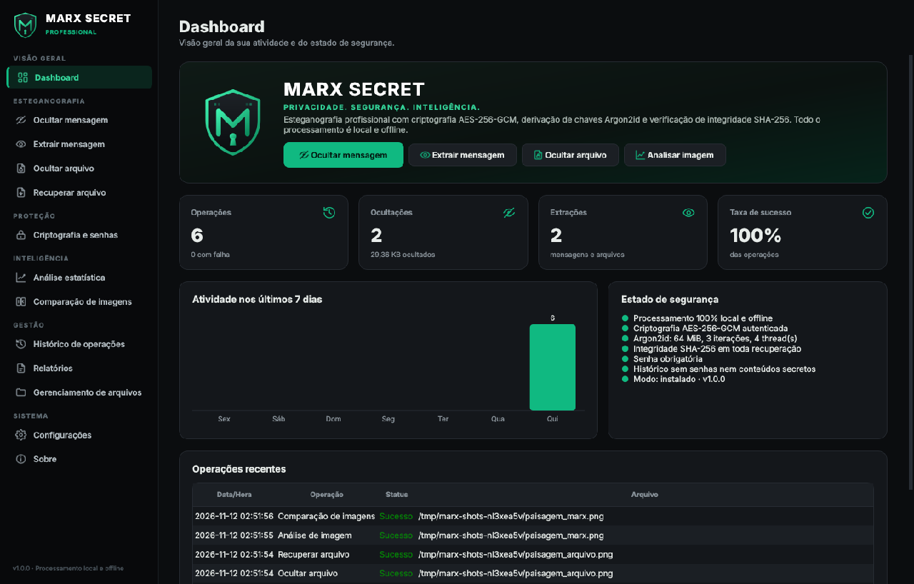
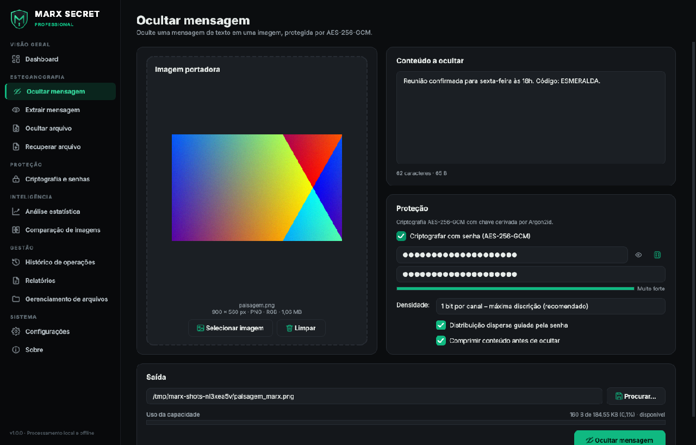
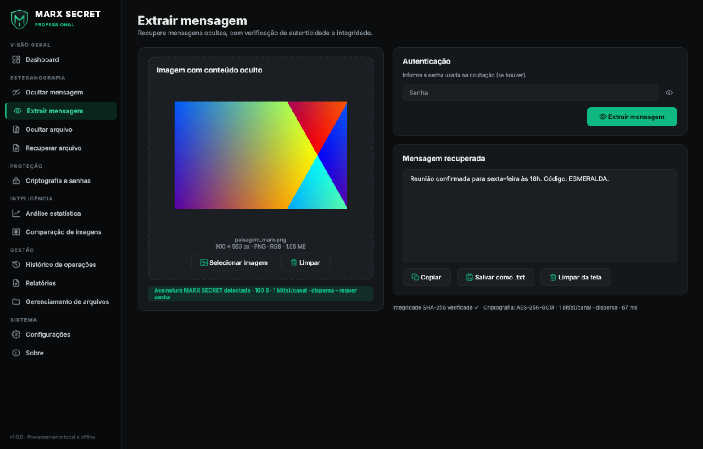
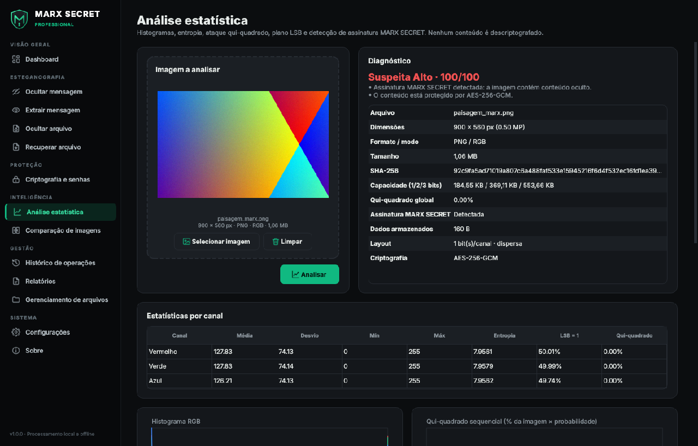
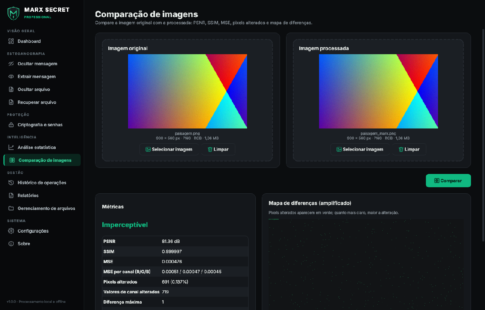
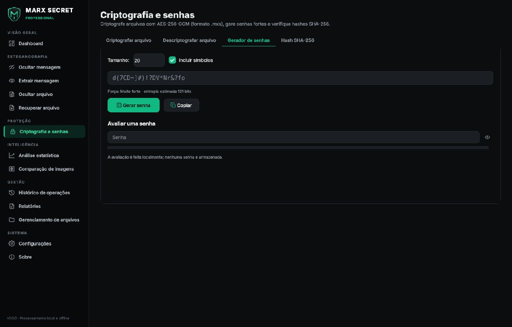
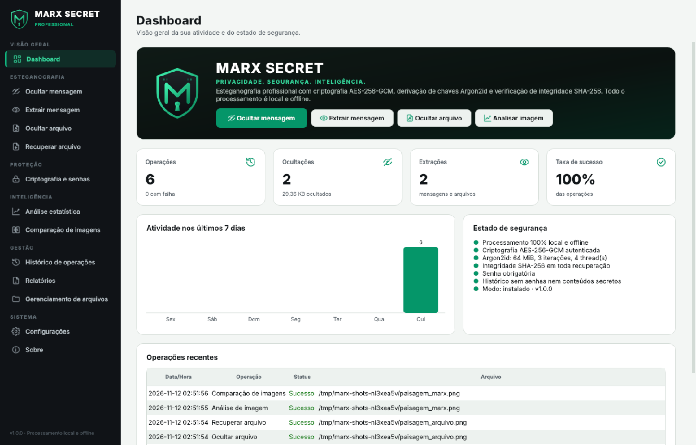

<p align="center">
  
</p>

<h1 align="center">MARX SECRET</h1>
<p align="center"><b>PRIVACIDADE. SEGURANÇA. INTELIGÊNCIA.</b></p>
<p align="center">MARX SECRET Professional — software profissional de esteganografia digital, criptografia,
ocultação e recuperação de mensagens e arquivos em imagens.</p>

---



## Recursos

| Módulo | O que faz |
|---|---|
| **Dashboard** | Indicadores, atividade dos últimos 7 dias, estado de segurança e operações recentes |
| **Ocultar / extrair mensagem** | Texto oculto em imagens com AES-256-GCM + Argon2id e verificação SHA-256 |
| **Ocultar / recuperar arquivo** | Qualquer arquivo (até 256 MB) dentro de uma imagem, com nome preservado |
| **Criptografia e senhas** | Arquivos `.mxs` (AES-256-GCM), gerador e avaliador de senhas, verificação SHA-256 |
| **Análise estatística** | Histogramas, entropia, ataque qui-quadrado global/sequencial, plano LSB, detecção de assinatura |
| **Comparação de imagens** | PSNR, SSIM, MSE, pixels alterados e mapa de diferenças |
| **Histórico** | Registro local (SQLite) pesquisável, filtrável e exportável — sem senhas nem conteúdos |
| **Relatórios** | PDF com identidade visual e CSV (Excel pt-BR) por período e tipo |
| **Gerenciamento de arquivos** | Identificação de imagens com conteúdo, hashes e exclusão segura |
| **Configurações** | Tema escuro/claro, perfil Argon2id, densidade LSB, limites, privacidade |

Recursos avançados: 1–3 bits por canal, **distribuição dispersa** dos bits guiada pela senha,
compressão automática, verificação pós-gravação, canal alfa preservado, limpeza automática da
área de transferência, autodiagnóstico offline (`--self-test`), modo portátil.

## Downloads (entrega)

| Pacote | Arquivo |
|---|---|
| Marx Secret - Instalação tradicional no Windows | `MARX_SECRET_Setup.exe` |
| Marx Secret - Executar sem instalação tradicional | `MARX_SECRET_Portable.zip` |
| Marx Secret - Projeto completo e código-fonte | `MARX_SECRET_Source.zip` |
| Marx Secret - Manual de instalação e utilização | [`Manual_MARX_SECRET.pdf`](docs/Manual_MARX_SECRET.pdf) |

Os quatro pacotes são gerados automaticamente pelo GitHub Actions
(workflow **MARX SECRET – testes e build Windows**) em um runner Windows: o artefato
`MARX_SECRET_Entrega` contém as quatro pastas nomeadas acima. Ao criar uma tag `v*`
(ex.: `v1.0.0`) os arquivos também são publicados como *Release*.

Requisitos: Windows 10 (1809+) ou Windows 11, 64 bits. Não é necessário instalar Python.

## Segurança em resumo

- **Esteganografia LSB** nos canais RGB (alfa intacto), sequencial ou dispersa.
- **AES-256-GCM** (criptografia autenticada; cabeçalho autenticado como AAD).
- **Argon2id** (sal de 128 bits; perfis 19/64/256 MiB) para derivar a chave.
- **SHA-256** do conteúdo original verificado em toda recuperação.
- Validação de entradas, limites de tamanho (imagem ≤ 100 MP / 300 MB; conteúdo ≤ 256 MB),
  saneamento de nomes de arquivos, proteção contra *decompression bombs* e injeção em CSV.
- 100% local e offline; senhas nunca são armazenadas; histórico e relatórios sem conteúdo secreto;
  exclusão segura de arquivos e temporários (quando tecnicamente possível).

Detalhes em [docs/SEGURANCA.md](docs/SEGURANCA.md) e [docs/ARQUITETURA.md](docs/ARQUITETURA.md).

## Executar a partir do código-fonte

```bash
python -m venv .venv
# Windows: .venv\Scripts\activate    Linux/macOS: source .venv/bin/activate
pip install -r requirements-dev.txt
python -m marx_secret            # abre a interface
python -m marx_secret --self-test # autodiagnóstico offline
python -m pytest -q               # testes automatizados
```

## Gerar os instaladores (Windows)

```powershell
powershell -ExecutionPolicy Bypass -File scripts\build_windows.ps1
```

O script cria o ambiente de build, roda os testes, gera o manual, o executável (PyInstaller),
a versão portátil, o ZIP do código-fonte e o instalador (Inno Setup 6, instalado
automaticamente se ausente), e organiza tudo em `release\MARX_SECRET_Entrega\`.

## Estrutura do projeto

```
marx_secret/
  core/        criptografia, contêiner, LSB, imagens, análise, comparação, exclusão segura
  data/        banco SQLite (histórico e configurações)
  services/    operações de alto nível (usadas pela GUI e pelo autodiagnóstico)
  reports/     relatórios PDF e CSV
  ui/          interface PySide6 (tema, ícones, componentes, páginas)
  assets/      logotipo e ícones
tests/         testes automatizados (núcleo, serviços, banco, relatórios, GUI)
installer/     PyInstaller (.spec), metadados do .exe e Inno Setup (.iss)
scripts/       build_windows.ps1
tools/         geração de ativos, capturas, manual, ZIP de fonte e pacote de entrega
docs/          manual em PDF, documentação técnica e capturas de tela
```

## Capturas de tela

| | |
|---|---|
|  |  |
|  |  |
|  |  |

---

© 2026 MARX SECRET. Todos os direitos reservados. Veja [docs/TERMOS_DE_USO.txt](docs/TERMOS_DE_USO.txt).
